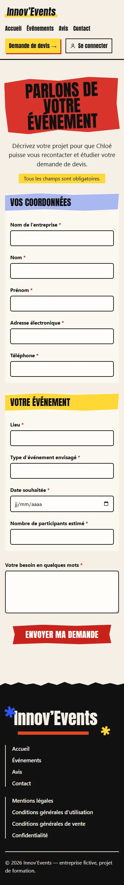
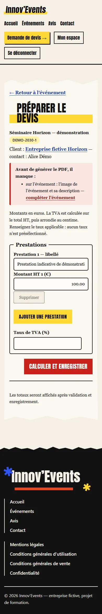
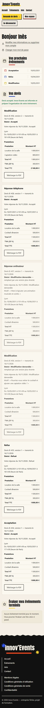

# Adaptation des écrans web aux petits écrans
Tâche [#5](https://github.com/RomainRas/innovevents-manager/issues/5).

## Maquettes à 390 pixels
Les trois écrans web principaux ont une version à 390 pixels de large. Elles représentent le site web consulté sur téléphone ; elles sont distinctes des trois écrans de l’application mobile destinée à Chloé et José.

| Demande de devis | Préparation du devis | Consultation du devis |
| --- | --- | --- |
|  |  |  |

## Sources et choix
La page 4 de l’[énoncé](../enonce/enonce-ecf-cda.pdf) demande un menu accessible sur les pages et une interface adaptée au support ; la page 6 précise les exigences d’accessibilité. Les pages 8–10 définissent les formulaires et actions concernés. La largeur de 390 pixels et l’organisation ci-dessous sont des choix de conception, pas des dimensions imposées par le sujet.

## Réorganisation
### Navigation
- L’en-tête passe sur plusieurs lignes : nom Innov’Events, liens Accueil, Événements, Avis et Contact, puis Demande de devis et Connexion ou Mon espace et Déconnexion selon le contexte.
- Aucune fonctionnalité n’est masquée sur téléphone : les rubriques des espaces connectés restent accessibles depuis le tableau de bord.
- Le pied de page empile la marque, la navigation et les liens légaux.

### WEB01 — Demande
- Champs empilés sur une colonne, avec leurs libellés et indications obligatoires.
- Dix champs conservés : entreprise, nom, prénom, email, téléphone, lieu, type, date, participants et besoin.
- Bouton d’envoi sur la largeur disponible ; décor d’affiche réduit pour laisser la place au formulaire.

### WEB02 — Préparation
- Client, informations manquantes, prestations, TVA, puis totaux, PDF et transmission dans l’ordre de lecture.
- Chaque prestation empile libellé, montant HT et retrait ; l’ajout de prestation demeure disponible.
- Les totaux et le bloc PDF passent l’un sous l’autre.

### WEB03 — Consultation
- Prochains événements, puis devis du plus récent au plus ancien.
- Les prestations restent en tableau à deux colonnes, montants alignés à droite.
- Les actions de téléchargement, acceptation, demande de modification et refus passent à la ligne sans être coupées.

## Vérifications
- Pages contrôlées à 1440 et 390 pixels : aucun défilement horizontal (mesuré par les tests de navigateur).
- Boutons et liens d’action d’au moins 44 à 48 pixels de haut.
- Textes longs (noms d’entreprise, adresses, e-mails) qui reviennent à la ligne sans être coupés.
- Focus clavier visible et erreurs affichées près des champs, décrits dans les [compléments de formulaires](formulaires-reprise-erreurs-focus.md).

Le [bilan de couverture](bilan-couverture-ecrans.md) distingue ces écrans représentatifs des autres pages de l’application.
