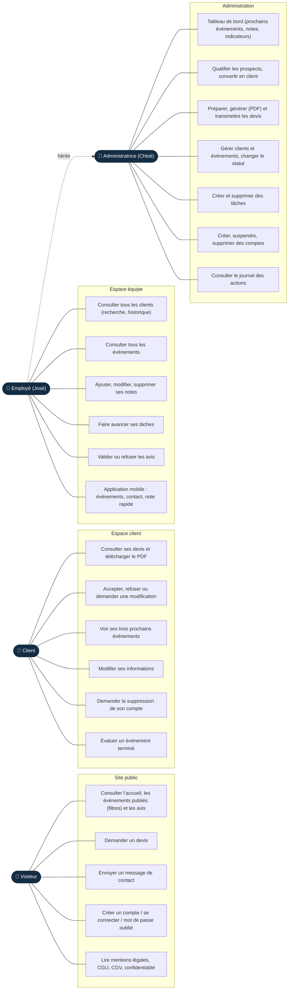
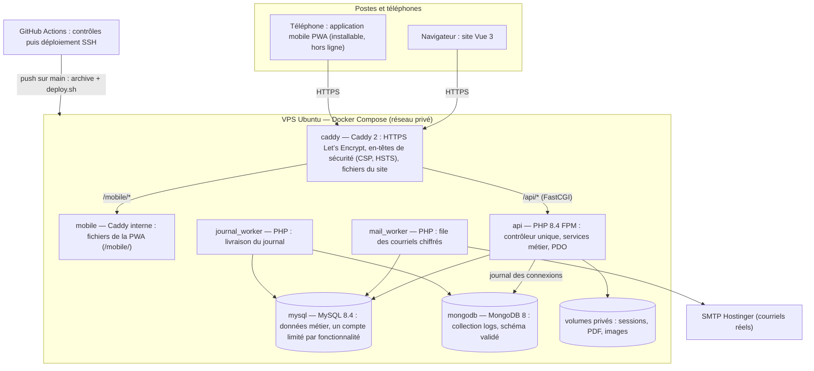

# Diagrammes : cas d’utilisation, séquence et architecture

Établie à partir de l’application réalisée. Compléments : [MCD](mcd-relationnel.md), [MLD MySQL](mld-mysql.md), [modèle des journaux MongoDB](modele-journaux-mongodb.md), [enchaînement des écrans](enchainement-ecrans.md), [déploiement](../deploiement.md).

Les schémas sont écrits en Mermaid : GitHub les affiche directement.

## 1. Cas d’utilisation

L’employé hérite des cas du compte connecté ; l’administratrice hérite de tous les cas de l’employé. Le visiteur devient client par la conversion de sa demande de devis (ou par création de compte).



## 2. Diagramme de séquence : le client accepte un devis

Fonctionnalité centrale du parcours commercial ; elle traverse toutes les couches (présentation, API, métier, données) et les deux bases.

```mermaid
sequenceDiagram
  autonumber
  actor Client
  participant Vue as Site Vue (navigateur)
  participant Caddy as Caddy (HTTPS)
  participant API as API PHP (Kernel)
  participant Auth as Authentication / WebSession
  participant Svc as ClientQuotes (métier)
  participant SQL as MySQL (compte ecf_quote_decision)
  participant JW as journal_worker
  participant Mongo as MongoDB (logs)
  participant MW as mail_worker
  participant SMTP as Serveur SMTP

  Client->>Vue: « Accepter le devis… » puis « Confirmer l’acceptation »
  Vue->>Caddy: POST /api/me/quote-decision {version_id, choix, clé d’opération} + X-CSRF-Token
  Caddy->>API: FastCGI (en-têtes de sécurité ajoutés au retour)
  API->>Auth: session valide ? jeton CSRF ? rôle client ?
  Auth-->>API: utilisateur connecté (sinon 401 / 403)
  API->>Svc: decide(données JSON)
  Svc->>Svc: valider identifiant, choix, clé (format UUID)
  Svc->>SQL: GET_LOCK sur le devis, BEGIN
  Svc->>SQL: clé d’opération déjà utilisée ? (rejeu sans double réponse)
  Svc->>SQL: SELECT … FOR UPDATE (version, événement, propriétaire)
  alt devis d’un autre client ou inexistant
    Svc-->>API: 404 (aucune information divulguée)
  else version remplacée ou déjà décidée
    Svc-->>API: 409
  else acceptation valide
    Svc->>SQL: INSERT decisions_devis ; UPDATE version → « accepte »
    Svc->>SQL: UPDATE événement brouillon → « accepte »
    Svc->>SQL: INSERT journal_a_emettre (CHANGEMENT_STATUT_EVENEMENT)
    Svc->>SQL: INSERT courriels_a_envoyer (contenu chiffré, notification agence)
    Svc->>SQL: COMMIT, RELEASE_LOCK
    Svc-->>API: {statut: accepte}
  end
  API-->>Vue: 200 JSON
  Vue-->>Client: « Devis accepté », liste rechargée, focus sur le message
  par traitement asynchrone
    JW->>SQL: lire les entrées en attente
    JW->>Mongo: insertOne (schéma validé) puis marquer « livré »
  and
    MW->>SQL: lire le courriel en attente, déchiffrer
    MW->>SMTP: envoyer à l’agence, marquer « envoyé »
  end
```

Points de conception visibles sur la séquence : écriture du journal et du courriel **dans la même transaction** que la décision (rien n’est perdu si MongoDB ou le SMTP est indisponible ; le traitement reprend ensuite), verrou et clé d’opération contre les doubles clics ou réponses perdues, réponse identique pour un devis inexistant ou appartenant à un autre client.

## 3. Architecture logicielle



### Rôle des couches et sécurité

| Couche | Composants | Rôle | Sécurité |
| --- | --- | --- | --- |
| Présentation | Site Vue 3 (`frontend/`), PWA (`mobile/`) | Écrans, formulaires, accessibilité (focus, erreurs reliées aux champs) | Aucun secret côté client ; affichage échappé par Vue ; données mobiles en cache effacées à la déconnexion |
| Façade | Caddy | HTTPS, compression, fichiers statiques, relais vers l’API et la PWA | Certificat automatique, HSTS, CSP stricte (`script-src 'self'`), `X-Frame-Options DENY`, taille des requêtes limitée |
| API (contrôle) | `Http/Kernel.php` | Table des routes et méthodes, décodage JSON borné, codes HTTP | Session HttpOnly, jeton CSRF + contrôle d’origine sur chaque écriture, erreurs génériques sans détail technique |
| Métier | `Service/*` | Règles : rôles, transitions de statut, calculs en centimes, idempotence, verrous | Contrôle du rôle dans chaque service, mêmes réponses pour « inexistant » et « interdit à vous » |
| Accès aux données | PDO (requêtes préparées), bibliothèque MongoDB | Lecture et écriture | Un compte MySQL **par fonctionnalité**, limité aux colonnes nécessaires ; transactions ; journal écrit dans la même transaction |
| Données | MySQL, MongoDB, volumes | Persistance | Contraintes `CHECK` et clés étrangères, schéma MongoDB validé, mots de passe hachés (bcrypt), courriels en file chiffrés (libsodium), secrets hors Git |
| Tâches de fond | `mail_worker`, `journal_worker` | Envois et livraison asynchrones avec reprise | Comptes dédiés, reprise après panne sans perte |

### Éco-conception

- Pas de framework CSS ni de bibliothèque d’interface : feuilles de style légères ; le site compilé pèse environ 200 Ko de JavaScript (65 Ko compressés).
- Compression zstd/gzip, mise en cache longue des fichiers versionnés, cache d’une heure pour les images publiques.
- Images ré-encodées à l’envoi (JPEG ou PNG, 5 Mo au plus), ce qui retire aussi leurs métadonnées ; aucune vidéo ; aucune police téléchargée (police déjà installée sur l’appareil ou police du système).
- Listes limitées côté serveur (200 éléments au plus), aucune requête répétée en arrière-plan.
- L’application mobile n’interroge le serveur qu’à l’ouverture d’un écran et réutilise les données en cache hors ligne.
- Un seul serveur virtuel ; les services inutiles en production (outils de test) ne sont pas installés.
