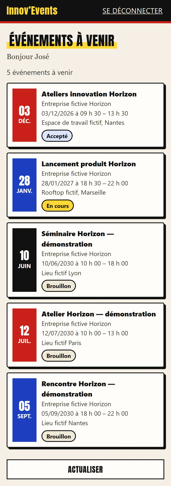

# Maquette mobile 01 - Événements à venir

Tâche [#5](https://github.com/RomainRas/innovevents-manager/issues/5).

- [Wireframe et règles](wireframe-mobile-01-evenements-a-venir.md).
- [Charte graphique](charte-graphique.md) et [toutes les maquettes](maquettes-ecrans.md).

Écran d’ouverture de l’application mobile de Chloé et José. Il représente l’application de l’équipe, pas une déclinaison responsive du site public.

## Contenu et direction graphique

Les exigences de l’énoncé page 14 sont conservées : liste claire des événements à venir à l’ouverture et accès à la fiche de chaque événement. Les liens CGU et CGV sont accessibles depuis l’écran de connexion.

- Bandeau noir liséré de rouge avec le nom en Anton jaune ; titre surligné de jaune.
- Une carte par événement : bloc de date en couleur (rouge, bleu, noir en alternance), nom, client, horaires, lieu et statut.
- Cartes claires à contour noir et ombre portée ; toute la carte est cliquable.
- Actions de 48 pixels de haut au moins.

La liste n’est pas limitée en nombre ; elle est triée du plus proche au plus lointain.

## États

Chargement, liste vide, erreur réseau, session expirée et consultation hors ligne sont décrits dans le document du wireframe.
