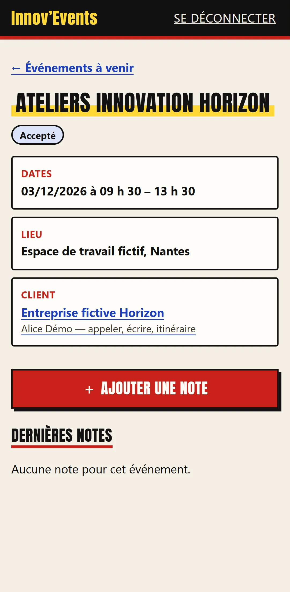

# Maquette mobile 02 - Fiche événement et ajout de note

Tâche [#5](https://github.com/RomainRas/innovevents-manager/issues/5).

- [Wireframe et règles détaillées](wireframe-mobile-02-fiche-evenement.md).
- [Charte graphique](charte-graphique.md) et [toutes les maquettes](maquettes-ecrans.md).

## Correspondance avec le sujet

La page 14 de l’[énoncé ECF](../enonce/enonce-ecf-cda.pdf) a été relue directement avant réalisation.

| Consigne | Représentation |
| --- | --- |
| Nom, dates, lieu et client associé | Titre surligné, cartes Dates, Lieu et Client |
| Nom du client cliquable vers sa fiche contact | Lien portant le nom de l’entreprise, rappel du contact et des actions |
| Bouton Ajouter une note bien visible | Grand bouton rouge « + Ajouter une note » sous les informations, visible sans défiler |
| Interface simple de saisie et enregistrement | Zone de saisie qui prend le focus et bouton d’enregistrement |

## Choix de conception

Bandeau noir liséré de rouge, cartes claires à contour noir, libellés en rouge et en majuscules, titres en Anton. Les boutons font au moins 48 pixels de haut. Le nom de l’événement reste rappelé pendant la saisie pour éviter une note sur la mauvaise fiche. Les cinq dernières notes s’affichent sous le bouton, chacune marquée d’un filet bleu.

Après un enregistrement réussi, la note apparaît en tête de liste avec un message. Une note vide est refusée ; un échec conserve le texte et permet de réessayer. Les [six états de note](etats-note-mobile.md) détaillent vide, attente, succès, échec, résultat incertain et abandon.
