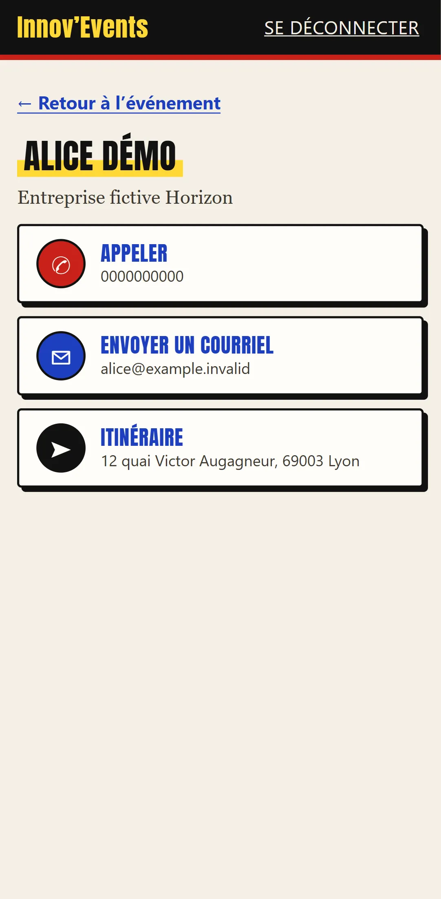

# Maquette mobile 03 - Fiche client

Tâche [#5](https://github.com/RomainRas/innovevents-manager/issues/5).

- [Wireframe, sources et règles détaillées](wireframe-mobile-03-fiche-client.md).
- [Charte graphique](charte-graphique.md) et [toutes les maquettes](maquettes-affiche.md).

Consultation des coordonnées et accès aux applications de contact du téléphone, depuis la fiche événement.

## Consignes et choix de conception

La maquette reprend les exigences de la page 14 de l’[énoncé](../enonce/enonce-ecf-cda.pdf) et le contenu du wireframe.

| Exigence | Représentation |
| --- | --- |
| Accès depuis le nom du client sur la fiche événement | Fiche client avec retour à l’événement |
| Numéro cliquable ouvrant le téléphone | Carte « Appeler » avec le numéro |
| Adresse e-mail cliquable ouvrant la messagerie | Carte « Envoyer un courriel » avec l’adresse |
| Adresse postale cliquable ouvrant un itinéraire | Carte « Itinéraire » avec l’adresse du client |

L’adresse postale appartient au client ; elle n’est pas déduite du lieu de l’événement.

Nom du contact en titre Anton surligné de jaune, entreprise en sous-titre. Chaque action est une grande carte à contour noir et ombre portée, avec une pastille ronde (rouge, bleue, noire) et un libellé en Anton bleu ; elle mesure au moins 72 pixels de haut. Une coordonnée absente est affichée comme indisponible, en gris, sans lien.

Les [six états de contact mobile](etats-contact-mobile.md) décrivent les coordonnées absentes et les ouvertures impossibles. Les noms, e-mails et adresses longs reviennent à la ligne sans couper les informations.
