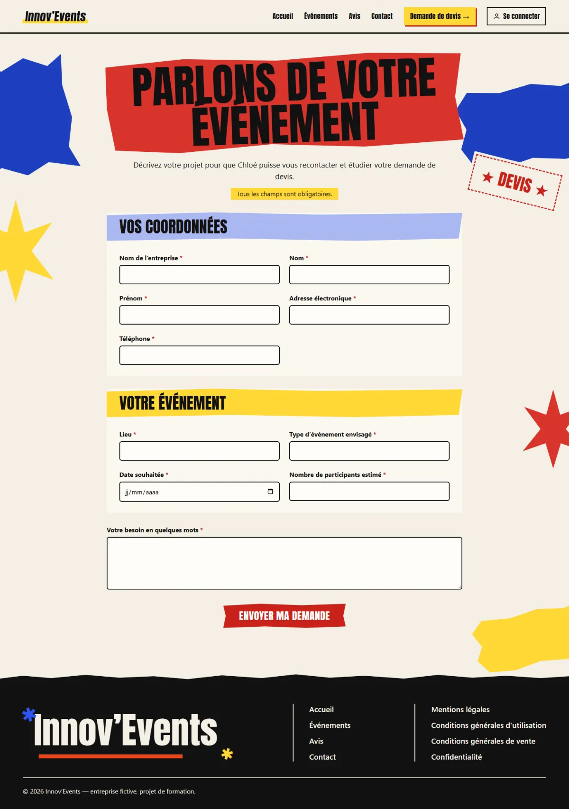
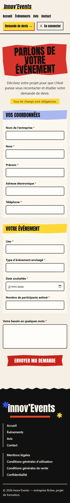

# Maquette web 01 - Demande de devis

Tâche [#5](https://github.com/RomainRas/innovevents-manager/issues/5).

- [Wireframe et règles du formulaire](wireframe-web-01-demande-devis.md).
- [Charte graphique](charte-graphique.md) et [toutes les maquettes](maquettes-ecrans.md).

## Exigences conservées

Les dix champs obligatoires de la page 8 de l’énoncé sont présents : entreprise, nom, prénom, e-mail, téléphone, lieu, type d’événement, date, nombre de participants et description du besoin.

Le menu commun comprend Accueil, Événements, Avis, Contact, Demande de devis et Connexion. Les mentions légales sont accessibles dans le pied de page. L’envoi ne nécessite pas d’inscription préalable.

Le texte d’accompagnement explique la prise de contact, puis la proposition si le projet peut être pris en charge. Il ne promet ni acceptation automatique du projet ni délai non fourni par le sujet.

## Direction artistique

- Page publique en style affiche : fond papier, aplats rouge, bleu et jaune en décor, titre en Anton surligné de jaune.
- Formulaire sur une feuille claire, regroupé par sections avec des libellés visibles au-dessus des champs.
- Action « Envoyer ma demande » mise en évidence ; boutons de 48 pixels de haut.
- Décor masqué aux lecteurs d’écran.

L’identité n’est pas présentée comme la charte officielle d’une entreprise réelle.

## États et comportement

Les règles décrites dans le document du wireframe s’appliquent :
- Signaler les champs manquants et l’e-mail invalide, conserver la saisie.
- Empêcher les soumissions répétées pendant l’envoi.
- Afficher le message de remerciement après enregistrement effectif.
- Conserver la demande si seul le courriel de notification échoue.
- Focus visible, navigation clavier cohérente et erreurs compréhensibles.

La maquette montre l’état initial ; la [planche complémentaire](etats-demande-devis.md) décrit la confirmation, les erreurs de saisie, l’envoi en cours et l’échec d’enregistrement. Le site s’adapte au téléphone : voir l’[adaptation aux petits écrans](adaptation-web-petits-ecrans.md).
