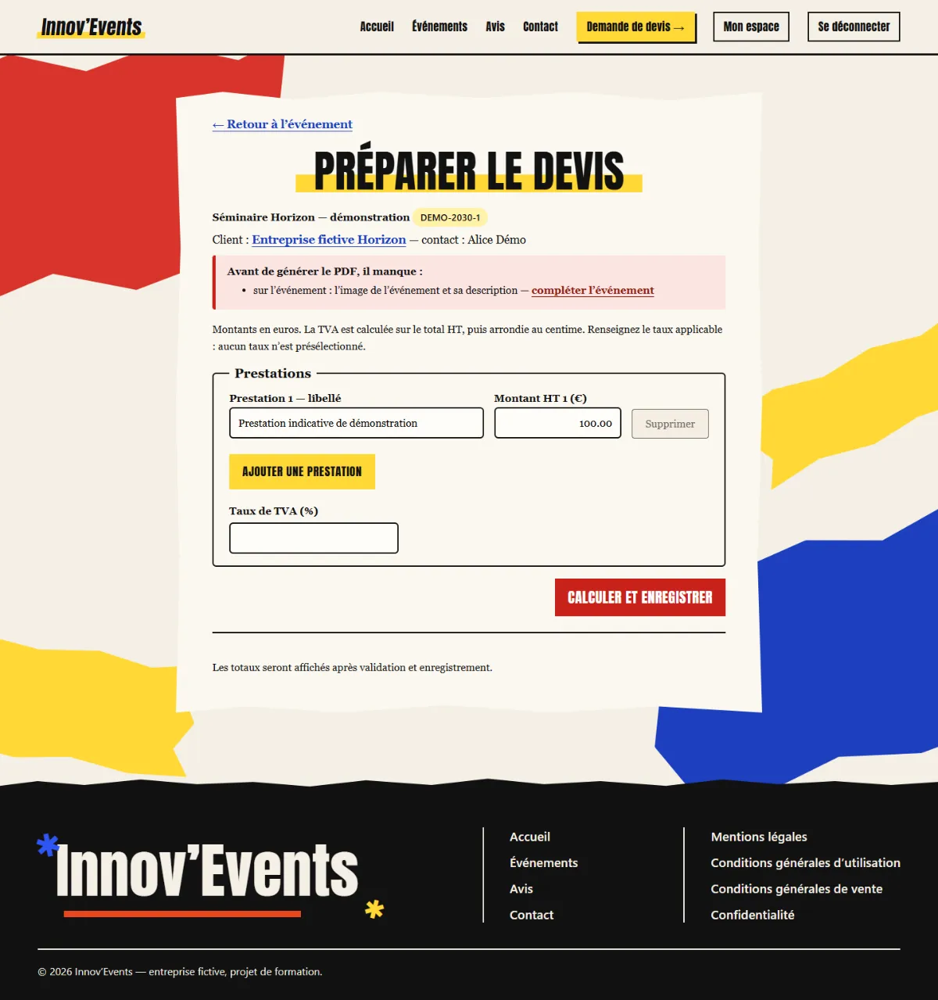
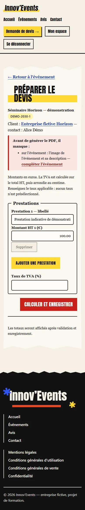

# Maquette web 02 - Préparation du devis

Tâche [#5](https://github.com/RomainRas/innovevents-manager/issues/5).

- [Wireframe, exigences et choix détaillés](wireframe-web-02-preparation-devis.md).
- [Charte graphique](charte-graphique.md) et [toutes les maquettes](maquettes-affiche.md).

Écran destiné à Chloé dans son espace d’administration.

## Périmètre et contenu

L’écran prépare le devis d’un événement en brouillon, après conversion du prospect en client :
- Client concerné et lien vers sa fiche ; liste de ce qui manque encore avant le PDF.
- Prestations avec libellé et montant HT, ajout et retrait de lignes.
- Taux de TVA, synthèse HT, TVA et TTC ; enregistrement du brouillon.
- Génération du PDF, téléchargement, envoi automatique ou confirmation d’un envoi manuel.

Les sources restent l’énoncé page 9 et la condition de visibilité publique page 7. La préparation, la génération du PDF, la transmission et la décision du client sont des étapes distinctes.

## Direction graphique

- Feuille claire sur fond papier avec aplats d’affiche en décor ; titre « Préparer le devis » en Anton surligné de jaune.
- Prestations regroupées dans un cadre à contour encre ; montants alignés à droite.
- Totaux à gauche, PDF à droite, séparés par un filet ; transmission en dessous.
- Action d’enregistrement rouge en Anton ; actions secondaires sur fond clair.
- Informations manquantes signalées dans un encadré rouge pâle avec liens pour les compléter.

## États représentés

Tant que le devis est incomplet, les actions PDF et transmission restent indisponibles et le texte indique ce qu’il faut compléter. Les erreurs, reprises après échec et transitions sont détaillées dans le document du wireframe et dans les [planches complémentaires](etats-preparation-transmission-devis.md) ; les [erreurs et le focus](formulaires-reprise-erreurs-focus.md) sont décrits à part. Le site s’adapte au téléphone : voir l’[adaptation aux petits écrans](adaptation-web-petits-ecrans.md).
