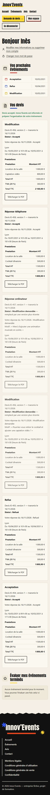

# Maquette web 03 - Consultation du devis

Tâche [#5](https://github.com/RomainRas/innovevents-manager/issues/5).

## Version actuelle (style affiche)

Cette maquette est la première version, dans la charte bleu nuit et turquoise. L’identité a ensuite évolué vers le style affiche (papier crème, rouge, bleu, jaune, titres en Anton) ; l’image ci-dessous montre l’écran tel qu’il est réalisé aujourd’hui. Les contenus, règles et états décrits plus bas restent valables. Tous les écrans actuels : [maquettes-affiche.md](maquettes-affiche.md).

## Travail réalisé

Troisième maquette web détaillée : le client connecté consulte le devis qui lui est affecté et choisit sa réponse.

- [Maquette Figma](https://www.figma.com/design/eAJJZyMSjoOff7mA1pNpCU?node-id=48-509).
- [Export SVG](../maquettes/web-03-consultation-devis.svg).
- [Wireframe, sources et règles](wireframe-web-03-consultation-devis.md).
- [Charte graphique](charte-graphique.md).

Le cadre mesure 1440 × 1885 pixels de contenu défilant. Le wireframe en niveaux de gris reste conservé séparément.

## Exigences conservées

L’écran reprend les exigences de l’énoncé page 10 :
- Consultation d’un devis affecté au client, avec retour vers la liste.
- Acceptation : statut accepté et courriel à Innov’Events.
- Demande de modification : motif obligatoire, statut modification et possibilité de contre-proposition par Chloé.
- Refus : statut refusé, sans motif supplémentaire imposé.
- Suivi du statut et widget des trois prochains événements les plus proches.

Les détails événement et prestations reprennent la proposition préparée page 9. Les montants, la devise, les dates et le taux sont des repères entre crochets, pas des valeurs inventées.

## Choix graphiques

- Navigation de l’espace client et panneau de réponse en bleu nuit.
- Bouton d’acceptation en turquoise ; refus identifié par son libellé et son texte rouge sur blanc.
- Demande de modification séparée, avec action corail.
- Cartes blanches, totaux sur fond clair et Total TTC mis en évidence.
- Police Inter et composants éditables conservés.

La couleur complète les libellés, elle ne remplace pas l’explication des actions. Le client ne peut pas modifier directement les prestations ou les montants.

## États et règles à développer

Les règles documentées dans le wireframe restent applicables : confirmation avant acceptation/refus, motif requis pour la modification, protection contre les doubles réponses, vérification du propriétaire, du statut et de la version courante côté serveur.

Après succès, le statut et un message doivent remplacer les actions. En cas d’échec d’enregistrement, ne pas annoncer un succès. L’échec du seul courriel ne doit pas effacer une acceptation enregistrée.

Cette maquette montre le devis en étude côté client. [deux planches complémentaires](etats-decisions-devis.md) représentent dix extraits : confirmations, résultats, motif requis, traitement en cours, échec confirmé, version remplacée et résultat réseau incertain. Ils restent statiques ; les interactions et contrôles serveur sont à développer. Aucun courriel ni aucune réponse réelle n’a été envoyé.

## Vérifications

- Présence des trois réponses, du motif obligatoire et du widget de trois événements.
- Menu commun, déconnexion et mentions légales conservés.
- Contrôle visuel complet : textes et boutons lisibles, sans chevauchement constaté.
- Export SVG préparé, éléments éditables maintenus.

Aucun test fonctionnel, d’autorisation, d’accessibilité clavier ou de responsive n’a été exécuté.

## Sauvegarde et suite

Figma reste la source modifiable. SVG et documentation sont sauvegardés sur dev. Les exports pour le dossier final seront préparés selon le format accepté au dépôt.

Avancement : six wireframes, six maquettes principales, les schémas d’enchaînement et les états complémentaires de demande et de décision du devis existent en première version.

## Adaptation aux petits écrans
Une variante à 390 pixels et son menu déplié sont maintenant dessinés, relus et sauvegardés. Voir les [visuels, règles de réorganisation et vérifications](adaptation-web-petits-ecrans.md). Cette étape complète les mentions antérieures de responsive restant à préparer ; les tests sur navigateur et appareil restent à réaliser pendant le développement. La relecture finale et les exports de rendu restent à terminer.
