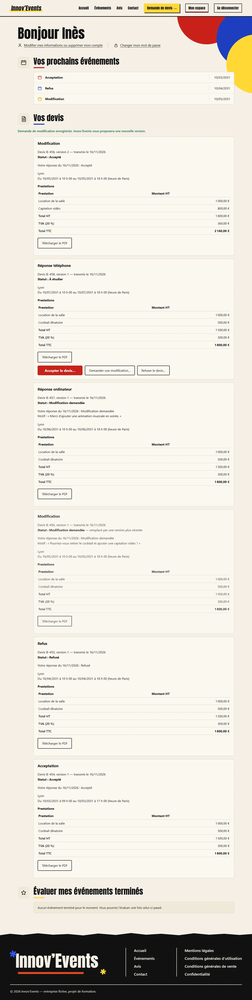

# Maquette web 03 - Consultation du devis

Tâche [#5](https://github.com/RomainRas/innovevents-manager/issues/5).

- [Wireframe, sources et règles](wireframe-web-03-consultation-devis.md).
- [Charte graphique](charte-graphique.md) et [toutes les maquettes](maquettes-affiche.md).

Le client connecté consulte les devis qui lui sont transmis et choisit sa réponse.

## Exigences conservées

L’écran reprend les exigences de l’énoncé page 10 :
- Consultation des devis affectés au client, avec leur version, leur date de transmission et leur statut.
- Acceptation : statut accepté et courriel à Innov’Events.
- Demande de modification : motif obligatoire, statut modification et possibilité de contre-proposition par Chloé.
- Refus : statut refusé, sans motif supplémentaire imposé.
- Suivi du statut et widget des prochains événements.

Les détails de l’événement et des prestations reprennent la proposition préparée page 9.

## Choix graphiques

- Espace client en style affiche : titre « Bonjour » en Anton, rubriques à pictogramme et filet de couleur.
- Chaque devis sur une carte claire : prestations en tableau, total TTC en gras, téléchargement du PDF.
- Réponses côte à côte : « Accepter » en rouge, « Demander une modification » et « Refuser » en boutons secondaires.
- Réponse déjà donnée affichée à la place des boutons, avec sa date et son motif.

La couleur complète les libellés, elle ne remplace pas l’explication des actions. Le client ne peut pas modifier directement les prestations ou les montants.

## États et règles

Confirmation avant acceptation ou refus, motif requis pour la modification, protection contre les doubles réponses, vérification du propriétaire, du statut et de la version courante côté serveur. Après succès, le statut et un message remplacent les actions ; en cas d’échec, aucun succès n’est annoncé. Les [planches complémentaires](etats-decisions-devis.md) décrivent les confirmations, résultats, erreurs, version remplacée et résultat réseau incertain. Le site s’adapte au téléphone : voir l’[adaptation aux petits écrans](adaptation-web-petits-ecrans.md).
