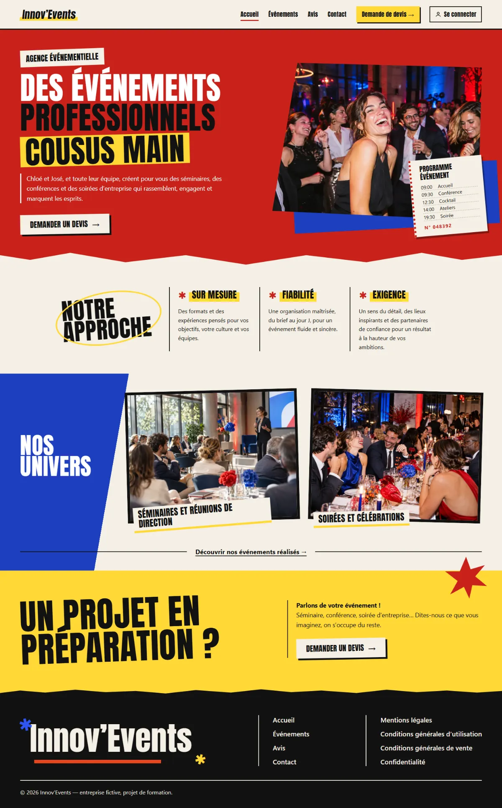
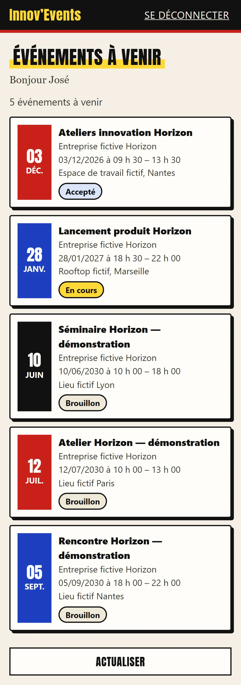
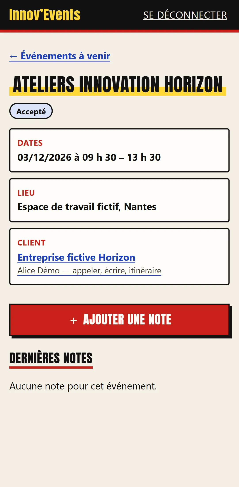
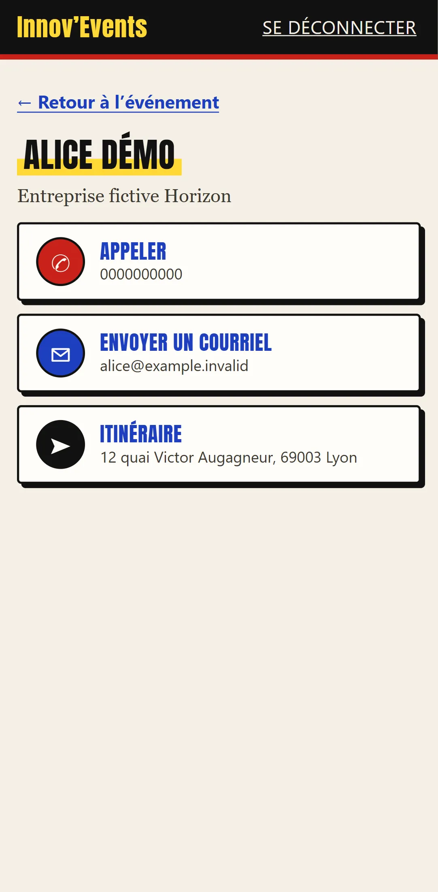

# Maquettes des écrans

L’identité d’Innov’Events s’inspire de l’affiche de spectacle : papier crème, aplats rouge #C8221A, bleu #1D3FBF et jaune #FFD836, encre #111, titres en Anton surlignés de jaune. La page d’accueil a été dessinée en premier ([maquette](../maquettes/charte/accueil-reference.webp)), puis chaque écran du site et de l’application mobile dans le même style.

Cette identité remplace une première charte plus sobre (bleu nuit et turquoise), jugée trop impersonnelle pour une agence événementielle : le sujet ne fixant pas de direction artistique, j’ai pris le temps de la faire évoluer. Les raisons sont détaillées dans la [charte graphique](charte-graphique.md#évolution-de-lidentité-visuelle).

Le site est présenté en largeur bureau (1440 pixels, images réduites à 1200) et l’application mobile en largeur téléphone. Les [wireframes](bilan-couverture-ecrans.md), états et [enchaînements](enchainement-ecrans.md) décrivent les parcours et contenus de ces écrans ; les règles de couleurs, de police et d’accessibilité sont dans la [charte graphique](charte-graphique.md).

## Site public (visiteur)

| Écran | Image |
| --- | --- |
| Accueil | [web-01](../maquettes/site/web-01-visiteur-accueil.webp) |
| Événements publics | [web-02](../maquettes/site/web-02-visiteur-evenements-publics.webp) |
| Détail d’un événement public | [web-03](../maquettes/site/web-03-visiteur-detail-evenement-public.webp) |
| Avis clients | [web-04](../maquettes/site/web-04-visiteur-avis.webp) |
| Demande de devis | [web-05](../maquettes/site/web-05-visiteur-demande-de-devis.webp) |
| Contact | [web-06](../maquettes/site/web-06-visiteur-contact.webp) |
| Connexion | [web-07](../maquettes/site/web-07-visiteur-connexion.webp) |
| Inscription | [web-08](../maquettes/site/web-08-visiteur-inscription.webp) |
| Mot de passe oublié | [web-09](../maquettes/site/web-09-visiteur-mot-de-passe-oublie.webp) |
| Mentions légales, CGU, CGV, confidentialité | [web-10](../maquettes/site/web-10-visiteur-mentions-legales.webp) · [web-11](../maquettes/site/web-11-visiteur-cgu.webp) · [web-12](../maquettes/site/web-12-visiteur-cgv.webp) · [web-13](../maquettes/site/web-13-visiteur-confidentialite.webp) |

## Administratrice (Chloé)

| Écran | Image |
| --- | --- |
| Tableau de bord | [web-14](../maquettes/site/web-14-chloe-tableau-de-bord.webp) |
| Demandes de devis et fiche demande | [web-15](../maquettes/site/web-15-chloe-demandes.webp) · [web-16](../maquettes/site/web-16-chloe-fiche-demande.webp) |
| Conversion en client | [web-17](../maquettes/site/web-17-chloe-conversion-en-client.webp) |
| Clients et fiche client | [web-19](../maquettes/site/web-19-chloe-clients.webp) · [web-20](../maquettes/site/web-20-chloe-fiche-client.webp) |
| Événements, fiche, modification, création | [web-21](../maquettes/site/web-21-chloe-evenements.webp) · [web-22](../maquettes/site/web-22-chloe-fiche-evenement.webp) · [web-23](../maquettes/site/web-23-chloe-modifier-evenement.webp) · [web-24](../maquettes/site/web-24-chloe-nouvel-evenement.webp) |
| Préparation de l’événement | [web-25](../maquettes/site/web-25-chloe-preparation-evenement.webp) |
| Préparation du devis | [web-26](../maquettes/site/web-26-chloe-preparation-devis.webp) |
| Suivi des devis | [web-27](../maquettes/site/web-27-chloe-suivi-des-devis.webp) |
| Paramètres des demandes | [web-28](../maquettes/site/web-28-chloe-parametres-demandes.webp) |
| Comptes | [web-29](../maquettes/site/web-29-chloe-comptes.webp) |
| Modération des avis | [web-30](../maquettes/site/web-30-chloe-moderation-avis.webp) |
| Journaux | [web-31](../maquettes/site/web-31-chloe-journaux.webp) |
| Mes informations, mot de passe | [web-32](../maquettes/site/web-32-chloe-mes-informations.webp) · [web-33](../maquettes/site/web-33-chloe-changer-mot-de-passe.webp) |

## Employé (José)

| Écran | Image |
| --- | --- |
| Tableau de bord | [web-34](../maquettes/site/web-34-jose-tableau-de-bord.webp) |
| Événements, clients, modération | [web-35](../maquettes/site/web-35-jose-evenements.webp) · [web-36](../maquettes/site/web-36-jose-clients.webp) · [web-37](../maquettes/site/web-37-jose-moderation-avis.webp) |

## Client (Alice)

| Écran | Image |
| --- | --- |
| Espace client (devis, avis) | [web-38](../maquettes/site/web-38-alice-espace-client.webp) |
| Mes informations | [web-39](../maquettes/site/web-39-alice-mes-informations.webp) |
| Devis transmis et réponses (accepter, modifier, refuser), client de test | [web-40](../maquettes/site/web-40-client-consultation-devis.webp) |

## Application mobile (équipe)

| Écran | Image |
| --- | --- |
| Connexion | [mobile-01](../maquettes/mobile/mobile-01-connexion.webp) |
| Événements à venir | [mobile-02](../maquettes/mobile/mobile-02-evenements-a-venir.webp) |
| Fiche événement et notes | [mobile-03](../maquettes/mobile/mobile-03-fiche-evenement.webp) |
| Fiche client (appeler, écrire, itinéraire) | [mobile-04](../maquettes/mobile/mobile-04-fiche-client.webp) |

## Petits écrans

Le site s’adapte au téléphone (390 pixels de large) ; les trois écrans web principaux :

| Écran | Image |
| --- | --- |
| Demande de devis | [web-05 petit écran](../maquettes/site/web-05-visiteur-demande-de-devis-petit-ecran.webp) |
| Préparation du devis | [web-26 petit écran](../maquettes/site/web-26-chloe-preparation-devis-petit-ecran.webp) |
| Consultation des devis par le client | [web-40 petit écran](../maquettes/site/web-40-client-consultation-devis-petit-ecran.webp) |

## Aperçu

  
  
  

