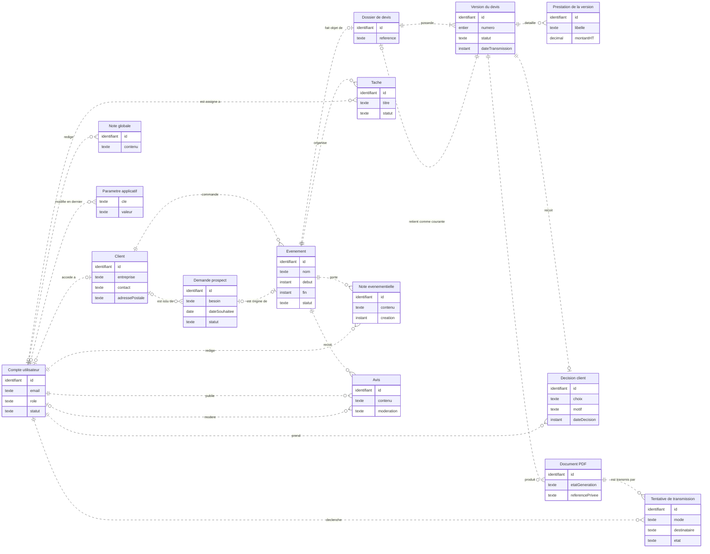

# Modèle conceptuel des données relationnelles — v1

Proposition issue du [dictionnaire](dictionnaire-donnees.md), du [parcours commercial](parcours-prospect-devis-evenement.md) et de la [matrice des droits](utilisateurs-et-droits.md). Référence : [énoncé](../enonce/enonce-ecf-cda.pdf), p. 17.

## Lecture et limites

Le modèle utilise une notation entité-association en pattes de corbeau, et non la notation graphique Merise avec ovales d'association. Il représente les concepts et leurs relations, sans clés étrangères ni types SQL physiques. Les attributs affichés sont des repères ; le dictionnaire reste la liste détaillée des informations.

À chaque extrémité, le symbole indique combien d'objets de ce côté correspondent à un objet de l'autre côté : `||` exactement un, `o|` zéro ou un, `o{` zéro à plusieurs, `|{` un à plusieurs. Exemple : un client commande zéro à plusieurs événements ; chaque événement appartient exactement à un client.

Les quinze entités appartiennent au périmètre MySQL. La collection MongoDB est documentée séparément dans le [modèle des journaux](modele-journaux-mongodb.md). Aucun lien entre les deux moteurs n'est présenté comme une clé étrangère automatique.

## Schéma conceptuel

Le schéma Mermaid est consultable dans GitHub. La génération FigJam a demandé la sélection d'une équipe : aucun lien FigJam créé ni contrôle visuel de son rendu n'est revendiqué à cette étape. Une exportation lisible du schéma reste à préparer après contrôle du rendu.

## Associations qui nécessitent une explication

| Association | Règle |
| --- | --- |
| Compte / client | Zéro ou une fiche par compte et réciproquement, choix de première version. Un compte interne n'est pas rattaché comme compte client. L'adresse e-mail seule ne donne pas de droit. |
| Client / demande | Une demande est liée à zéro ou un client ; un client peut regrouper plusieurs demandes. La liaison est créée à la conversion. |
| Demande / événement | Zéro ou un événement issu d'une demande dans la première version ; un événement peut être créé directement, sans demande. Le client doit être le même des deux côtés. |
| Événement / devis | Zéro ou un dossier de devis par événement ; toute contre-proposition appartient au même dossier, sous une nouvelle version. |
| Devis / versions | Au moins une version dès la création du dossier, dont exactement une version courante. Une version est courante pour zéro ou un dossier, et uniquement pour celui auquel elle appartient. |
| Version / décision | Zéro ou une décision par version. Le client ne décide que sur la version courante transmise ; un motif est requis pour une modification, pas pour un refus. |
| Version / prestations | Zéro ligne possible en brouillon ; au moins une ligne valide avant génération et transmission. |
| PDF / transmission | Chaque tentative porte sur un document d'une version déterminée. La version est retrouvée à travers le document ; pas de second rattachement indépendant susceptible de contredire le premier. |
| Utilisateur / tâches | Une tâche peut être non affectée. Lorsqu'elle est affectée, une seule personne interne en est responsable dans cette version. |
| Avis / modération | Un avis en attente peut n'avoir aucun modérateur. Après décision, conserver le modérateur et la date. L'auteur doit être client de l'événement terminé. |
| Paramètre / dernier auteur | L'auteur peut manquer pour la valeur initialisée ; les modifications par l'interface sont réservées à l'administrateur. |

La relation directe version/transmission du dictionnaire est donc **déduite** par version → document → transmission ; ce n'est pas un changement de règle métier. Les tentatives de génération échouées restent rattachées à la version avec une référence de fichier absente. Seul un document généré avec succès peut être envoyé.

## Contraintes au-delà des cardinalités

- Le couple dossier/numéro de version est unique ; le choix de version courante reste interne au dossier.
- Contenu, prestations et paramètres de calcul d'une version transmise sont figés. Le statut de traitement et la décision peuvent évoluer sans réécrire le contenu commercial.
- Un nouveau document doit représenter exactement la version retenue. En brouillon, toute modification invalide les PDF antérieurs pour une nouvelle transmission.
- L'événement issu d'une demande doit appartenir au client de cette demande.
- Le compte auteur d'une décision ou d'un avis doit être celui rattaché au client de l'événement ; les rôles des auteurs, affectataires et modérateurs restent contrôlés côté serveur.
- Publication : accord du client et visibilité demandée, avec statut différent de brouillon. Aucun prix dans la consultation publique.
- Les statuts du devis et de l'événement sont distincts. Une acceptation ne doit pas réussir partiellement ; la coordination relève d'une transaction métier.
- Les auteurs des notes et avis existent à la création. La suppression ou anonymisation ultérieure doit être conçue explicitement avant de choisir des actions de suppression en cascade.
- Un seul avis par auteur/événement est une décision de conception. L'échelle d'évaluation n'est pas fixée ici.
- Le schéma ne contient pas de compteur pour les widgets : trois événements prochains, cinq dernières notes et clients actifs se calculent à partir des données.
- Les sessions, reprises de courriels et mécanismes techniques de journalisation seront ajoutés au modèle physique si l'architecture les nécessite ; ce MCD ne prétend pas représenter leur implémentation.

## Relecture effectuée et reste à faire

Les relations ont été rapprochées du dictionnaire et des parcours : compte sans dossier, prospect non converti, client sans événement, événement sans devis, brouillon sans prestation, contre-proposition, tâche non affectée et avis en attente sont représentables. Les quinze entités du dictionnaire sont présentes ; aucun objet journal MongoDB n'est mêlé au modèle relationnel.

Cette relecture est documentaire. Le contrôle visuel du diagramme rendu, le MLD, les contraintes SQL, les scripts, les essais et la restauration restent à réaliser. Le MCD est une première version, pas une preuve de création des bases. Il servira à expliquer les associations dans la documentation technique du rendu.
